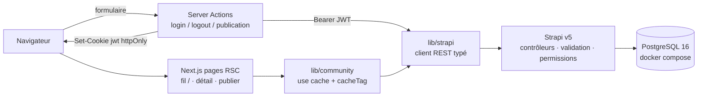

# Communauté Le Revenu — test technique

Espace communautaire destiné aux lecteurs du *Revenu*, développé dans le cadre du
test technique : une partie du prototype HTML fourni
(`maquette-communaute-le-revenu.html`) est transformée en application structurée
et maintenable — **Next.js (App Router)** côté frontend, **Strapi v5** pour la
logique métier et la persistance, **PostgreSQL** pour les données.

> L'intégralité de la logique métier et de la persistance passe par Strapi.
> Next.js n'accède jamais directement à PostgreSQL et n'implémente aucun
> backend parallèle.

## 1. Aperçu du projet

Le brief demande de remplacer une portion du prototype statique par une
application réelle : un fil de discussions financières (par espace thématique),
une page de détail par discussion avec ses réponses, la publication de nouvelles
discussions avec validation, et une notion minimale de membres authentifiés.
Le cahier des charges impose Strapi pour toute la logique métier et pour
l'exposition REST, et limite Next.js au rendu et à l'orchestration.

## 2. Fonctionnalités implémentées

- **Fil communautaire** (`/`) — discussions servies par l'API Strapi : titre,
  auteur, catégorie, nombre de réponses, date de publication ; filtrage par
  catégorie (`?espace=…`) et onglets de tri de la maquette (`?tri=…`,
  Tendances / Récentes / Sans réponse) ; états de chargement, vides et erreurs ;
  aucune discussion codée en dur dans les composants React.
- **Détail d'une discussion** (`/discussions/<documentId>`) — URL propre par
  discussion, contenu complet, réponses associées ; les réponses publiées sont
  persistées dans PostgreSQL via Strapi.
- **Création** (`/publier`) — type (question / discussion), titre ≥ 10
  caractères, contenu requis, choix de catégorie ; validation instantanée côté
  client (miroir des règles Strapi), re-validation serveur, puis redirection
  vers la discussion créée.
- **Session sécurisée minimale** — actions serveur de connexion/déconnexion,
  cookie httpOnly portant le JWT Strapi, attribution d'auteur imposée côté
  serveur.

## 3. Stack technique

| Couche | Technologies |
|---|---|
| Frontend | Next.js 16 (App Router), React 19, TypeScript, Tailwind CSS |
| Backend | Strapi v5 (5.59.0), TypeScript, API REST, Users & Permissions |
| Base de données | PostgreSQL 16 (Docker Compose) |
| Tests | Node.js test runner intégré (API, unitaire) · Playwright (E2E) |

## 4. Architecture



Points clés : le JWT reste dans un cookie httpOnly (le frontend le relaie vers
Strapi via `Bearer`), le filtrage et le tri côté backend, la réécriture
d'URL 404 réelle par le proxy, et une lecture revalidée par écriture
(`updateTag` dans les actions).

## 5. Structure du projet

```
frontend/                      Next.js 16
  app/                         routes : fil /, détail /discussions/[slug], /publier
    actions/                   server actions (login, logout, création discussion/réponse)
  components/                  UI dérivée de la maquette (cartes, formulaires, panneau membre…)
  lib/
    strapi.ts                  client REST Strapi typé (point d'intégration unique)
    community.ts               couche données : lectures mises en cache + helpers d'écriture
    auth.ts                    helpers session (cookies httpOnly)
    cookie-secure.ts           résolution pure du flag Secure (testée unitairement)
  e2e/                         parcours Playwright + mobile-check.mjs
  tests/                       test unitaire du flag Secure (node --test)
  proxy.ts                     404 réelle pour un id de discussion inconnu
backend/                       Strapi v5
  src/api/{category,discussion,reply}/   schémas, contrôleurs, services, routes
  src/utils/                   seed.ts (données de démo), serialize.ts, validation.ts
  tests/                       tests API node:test + cleanup-ph5.sql
  types/generated/             types TypeScript générés par Strapi
docker-compose.yml             service PostgreSQL (le seul conteneur)
maquette-communaute-le-revenu.html   prototype original (référence visuelle)
Test_technique_*.pdf           brief du test technique
docs/                          matrice d'acceptance + guide de revue technique
```

## 6. Prérequis

- Docker Desktop (Compose v2).
- Node.js ≥ 20.19 avec npm ≥ 10 (développement réalisé sous Node 24).
- Ports locaux libres : **5432** (PostgreSQL), **1337** (Strapi), **3000** (Next.js).

## 7. Quick Start — démarrage reproductible

Depuis une machine vierge, cloner puis configurer les variables d'environnement
(section 8), puis lancer les trois composants. Utilisez **un terminal par
service** (ou exécutez les blocs successivement).

### 7.1 Base de données (racine du dépôt)

```sh
docker compose up -d
docker compose ps        # attendre  « healthy »  (pg_isready)
```

### 7.2 Backend Strapi (dossier `backend/`)

```sh
cd backend
npm ci
npm run develop          # http://localhost:1337
```

Au premier démarrage, PostgreSQL reçoit le schéma Strapi puis, parce que
`SEED_DEMO_DATA=true` est présent dans `backend/.env`, le seed idempotent de
`src/utils/seed.ts` crée uniquement ce qui manque :

- **11 catégories thématiques** (Bourse, Économie, Épargne…) ;
- **3 membres de démonstration** : `demo_marie`, `demo_paul`, `demo_sophie` ;
- **6 discussions de démonstration avec 5 réponses**.

Relancer `npm run develop` ne duplique jamais rien (idempotent). Aucun panneau
d'administration n'est initialisé — le brief n'en a pas besoin.

### 7.3 Frontend Next.js (dossier `frontend/`)

```sh
cd frontend
npm ci
npm run dev              # http://localhost:3000
```

### 7.4 Vérifier le démarrage

| Vérification | Commande | Attendu |
|---|---|---|
| PostgreSQL | `docker compose ps` | `le-revenu-postgres … (healthy)` |
| Strapi | `curl -i http://localhost:1337/_health` | 204 No Content |
| Frontend | ouvrir <http://localhost:3000> | fil affiché avec les données seed |

## 8. Configuration détaillée des variables d'environnement

Copier les trois gabarits — les fichiers réels ne doivent **jamais** être
commités (ils sont ignorés par Git) :

```sh
cp .env.example .env
cp backend/.env.example backend/.env
cp frontend/.env.example frontend/.env.local
```

(`cp` fonctionne tel quel sous PowerShell grâce à l'alias `Copy-Item`.)

Compléter les valeurs `change-me` :

| Fichier | Variable | Valeur |
|---|---|---|
| `.env` | `POSTGRES_PASSWORD` | mot de passe local fort |
| `backend/.env` | `APP_KEYS` | 4 chaînes aléatoires séparées par des virgules |
| `backend/.env` | `API_TOKEN_SALT`, `ADMIN_JWT_SECRET`, `JWT_SECRET`, `TRANSFER_TOKEN_SALT`, `ENCRYPTION_KEY` | chaînes aléatoires |
| `backend/.env` | `DATABASE_PASSWORD` | même valeur que `POSTGRES_PASSWORD` |
| `backend/.env` | `SEED_DEMO_DATA` | `true` (seed idempotent au démarrage) |
| `backend/.env` | `SEED_USER_PASSWORD` | mot de passe réservé aux membres de démo |
| `frontend/.env.local` | `NEXT_PUBLIC_STRAPI_URL` | `http://localhost:1337` |

Générer des valeurs aléatoires, par exemple :

```sh
node -e "console.log(require('crypto').randomBytes(24).toString('base64url'))"
```

Flag optionnel frontend : `COOKIE_SECURE=true` force le flag de cookie
`Secure` même sans en-tête HTTPS. Sinon il est résolu **par requête** :
`x-forwarded-proto: https` ⇒ `Secure` automatique (production derrière un
proxy TLS) ; le `http://localhost` de démo reste sans `Secure`, car les
navigateurs refusent les cookies Secure reçus sur http.

## 9. Comptes de démonstration et authentification

Publier une discussion ou une réponse exige d'être connecté comme membre
(le backend refuse les écritures anonymes). Connexion via le panneau
**Espace membre** présent sur toutes les pages :

- identifiants : `demo_marie`, `demo_paul` ou `demo_sophie` (minuscules, avec
  underscore) ;
- mot de passe : la valeur fixée dans `backend/.env` sous
  `SEED_USER_PASSWORD` (le comportement par défaut du code est documenté en un
  seul endroit, dans `backend/src/utils/seed.ts`).

La session est un JWT émis par Strapi conservé dans un cookie **httpOnly** —
jamais lisible par le JavaScript du navigateur — et l'auteur de chaque
soumission est déduit côté serveur depuis ce jeton.

## 10. Routes applicatives & API

### Pages (Next.js)

| Route | Rôle |
|---|---|
| `/` | fil de discussions : filtres `?espace=`, tri `?tri=` |
| `/discussions/<documentId>` | détail d'une discussion + réponses |
| `/publier` | formulaire de création (200/404/états gérés) |

### API REST (Strapi)

| Endpoint | Méthodes | Accès | Notes |
|---|---|---|---|
| `/api/categories` | GET | public | catalogue des espaces |
| `/api/discussions` | GET, POST | GET public · POST authentifié | paramètres `filters`/`sort`/`pagination` ; `documentId` en clef |
| `/api/discussions/<documentId>` | GET | public | détail avec relations peuplées |
| `/api/replies` | POST | authentifié | liée à la discussion, auteur imposé |
| `/api/auth/local` | POST | public | connexion membre (utilisée par le panneau) |
| `/_health` | GET | public | 204 quand Strapi est prêt |

Erreurs cohérentes : 400 avec messages par champ, 403 écriture non autorisée,
404 id inconnu. Aucune route de mise à jour ou suppression n'est ouverte.

## 11. Tests automatisés et vérifications

Prérequis : les sections 7.1–7.3 fonctionnent (PostgreSQL healthy, Strapi sur
1337, Next dev sur 3000). Les tests dépendent de ces services réels — ils ne
peuvent pas s'exécuter sans l'infrastructure locale.

Depuis la **racine** du dépôt :

```sh
cd backend && npm test
```

- **23 tests d'intégration backend** (`node --test`, `backend/tests/`) :
  bornes de validation du titre/contenu/catégorie, refus 403 des anonymes,
  protection contre l'usurpation d'auteur (paramètre `author` ignoré,
  JWT gagne), création de réponse et association, régressions de sécurité
  (aucun appel à une route de modification/suppression, absence de champs
  privés dans les payloads, aucun jeton dans le HTML rendu).

Depuis le dossier **`frontend`** :

```sh
npm test              # test unitaire : contrat du flag Secure (node --test)
npx playwright test   # 5 scénarios E2E = les 10 parcours imposés
node e2e/mobile-check.mjs   # 390×844 : pas de débordement horizontal, barre basse, sidebar masquée
```

Dernière brique de vérification (qualité statique et builds de production) :

```sh
cd frontend && npx tsc --noEmit && npm run lint && npm run build
cd ../backend && npm run build
```

**Nettoyage sécurisé des fixtures de tests.** Les suites ne créent que des
lignes marquées `[PH5TEST]` / `[E2E-PH5-…]`. Le script tracké
[`backend/tests/cleanup-ph5.sql`](backend/tests/cleanup-ph5.sql) supprime
exclusivement ces lignes (tables `*_lnk` d'abord) dans une transaction
idempotente — sous Windows PowerShell :

```sh
Get-Content backend/tests/cleanup-ph5.sql | docker compose exec -i postgres psql -U strapi -d le_revenu
```

Sous Linux/macOS :

```sh
docker compose exec -i postgres psql -U strapi -d le_revenu < backend/tests/cleanup-ph5.sql
```

Vérification après nettoyage (état de référence : 11 / 6 / 5 / 3) :

```sh
docker compose exec -T postgres psql -U strapi -d le_revenu -tAc "SELECT (SELECT count(*) FROM categories), (SELECT count(*) FROM discussions), (SELECT count(*) FROM replies), (SELECT count(*) FROM up_users)"
```

## 12. Mesures de sécurité

- **Aucun accès PostgreSQL depuis le frontend** — uniquement l'objet
  `lib/strapi.ts` ; aucune dépendance de driver de base de données.
- **JWT httpOnly + SameSite=Lax** ; flag `Secure` résolu par requête
  (`x-forwarded-proto: https` ⇒ Secure ; localhost http sans Secure ;
  `COOKIE_SECURE=true` en override manuel) — contrat verrouillé par un test
  unitaire et une assertion E2E.
- **Permissions côté Strapi, jamais côté app** : rôle public en lecture seule,
  rôle authentifié avec ajout de créations discussion/réponse, **aucune
  modification ni suppression ouverte**.
- **Auteur dérivé du JWT** : le champ `author` du payload est ignoré (testé
  contre l'usurpation).
- **Validation serveur** : titre 10–150, contenu requis, type en liste,
  catégorie existante, réponse ≥ 2 caractères — indépendante des contrôles
  client (miroir informatif uniquement).
- **Sérialisation limitée** : seuls `id` et `username` de l'utilisateur sont
  exposés ; jamais `email`, `provider`, `password` ou champs privés.
- proxy : un id de discussion inconnu est réécrit vers une vraie page 404
  avant rendu (dégradation gracieuse si Strapi est indisponible).
- Fichiers `.env` jamais commités ; les secrets vivent uniquement dans les
  fichiers locaux ignorés.

## 13. Décisions techniques & limites connues

- **Lecture revalidée par écriture** : lectures mises en cache (`use cache` +
  `cacheTag('community')`) ; les actions d'écriture appellent `updateTag`
  avant redirection — l'utilisateur relit sa contribution immédiatement.
- **Relations auteur `manyToOne`** (correction post-audit approuvée, appliquée
  sans migration destructive : `discussions_author_lnk` et
  `replies_author_lnk` conservent leurs lignes, index et FK inchangés) — un
  membre peut naturellement poster plusieurs discussions et réponses.
- **Double requête Strapi sur le détail** (tradeoff documenté) : le proxy
  vérifie l'existence (rejeu 404 réel) puis la page charge le contenu ; le
  cache du proxy éviterait un 404 erroné sur une discussion fraîchement créée —
  privilège la justesse sur l'appel supplémentaire.
- **Onglets dérivés sur la page chargée (25 éléments)** : filtrage, tri par
  date et pagination passent par le backend ; les deux onglets « Tendances » /
  « Sans réponse », dérivés de la maquette, sont calculés sur la page peuplée
  (pas de tri natif sur compteur de relations dans Strapi v5 REST).
- **Pagination** : `pageSize` 25 ; le fil affiche une seule page — la
  pagination ou le scroll infini relèvent des bonus.
- **Recherche, votes « Utile », profils, léger bootstrap admin** — bonus
  volontairement non implémentés (priorité au périmètre cœur).
- **HTTPS local** : le flag Secure suit la résolution par requête décrite en
  section 12 ; un déploiement HTTPS réel l'obtient automatiquement.
- **Réseau Docker sous Windows** : si les pools d'adresses par défaut de
  Docker Desktop sont épuisés, `docker compose up` peut échouer à créer le
  réseau du projet — ajuster la configuration `default-address-pools` au
  niveau de l'hôte.
- Strapi régénère `backend/types/generated/*.d.ts` au démarrage — ignorer le
  churn EOL.

## 14. Documentation complémentaire

- [`docs/acceptance-matrix.md`](docs/acceptance-matrix.md) — exigence par
  exigence du brief : implémentation, vérifications exécutées, résultats,
  limites ; inclut l'annexe d'audit indépendant et le journal de la migration
  d'auteur.
- [`docs/technical-review.md`](docs/technical-review.md) — plan de revue
  technique de 30 minutes (architecture, modèles, flux, sécurité, tests,
  arbitrages).
- [`maquette-communaute-le-revenu.html`](maquette-communaute-le-revenu.html) —
  prototype original (référence visuelle du rendu).
- Le brief original : `Test_technique_Developpeur_Full_Stack_Le_Revenu.pdf`.
